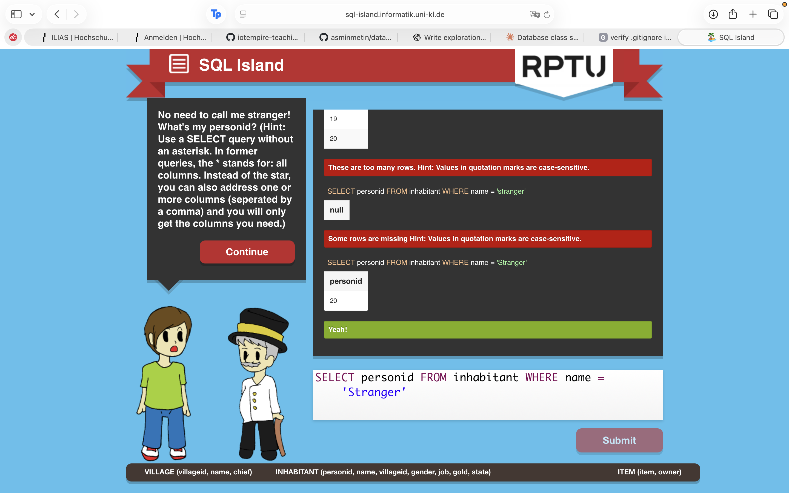

What have you learned about databases and SQL so far, just by playing? (Answer from the game alone — no looking things up.)
- Writing simple queries and reach to the required datas using different tables. 
Which SQL commands and patterns did you actually use (SELECT, WHERE, ORDER BY, joins, aggregate functions, …)?
- Select, from, where, like, order by, insert into, update
In your own words — after playing — what is a table, a row, a column, and a query?
- Table stores all the data we need, row contains one specific object, column categorises the information which has an exact type, and query helps us to locate what we are searching for. 
What surprised you? What is still confusing?
- Changing the job of a character in the game with only queires is interesting and using the multiple tables is still a bit confusing to me.

