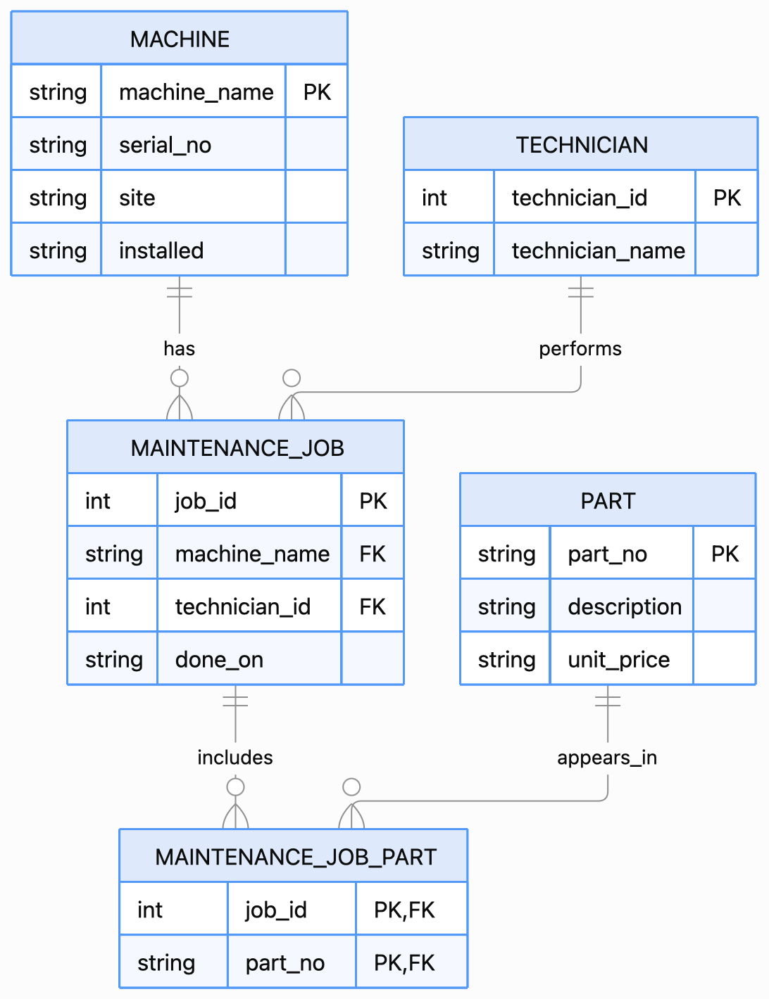

# 1. Entities, attributes, and intended primary keys:
**Entities:** 1.Machine, 2.Part, 3.Maintenance Job, 4.Technician
**Attributes:** 1.machine_name, serial_no, site, installed, 2.part_no, description, unit_price, 3.job_id, machine_name, technician, done_on, parts_used, 4.technician_name (stored in maint_job.technician)
**Intended primary keys:** 1.machine_name (inferred from maint_job.machine_name), 2.part_no (natural key), 3.job_id, 4.technician_id (would need to be added)
# 2.ER Diagram: 
# 3.Cardinalities checked against the sample data: 
**Parts used per job:**

SELECT job_id, parts_used,
       CASE
         WHEN parts_used IS NULL OR TRIM(parts_used) = '' THEN 0
         ELSE LENGTH(parts_used) - LENGTH(REPLACE(parts_used, ',', '')) + 1
       END AS n_parts
FROM maint_job
ORDER BY job_id;

| `job_id` | `parts_used` | `n_parts` |
|---:|---|---:|
| 1 | `P-1001,P-1002` | 2 |
| 2 | `P-1003` | 1 |
| 3 | `P-1001` | 1 |
| 4 | `NULL` | 0 recorded |

How many jobs record more than one part?

SELECT COUNT(*) AS jobs_with_multiple_parts
FROM maint_job
WHERE parts_used IS NOT NULL
  AND TRIM(parts_used) <> ''
  AND LENGTH(parts_used) - LENGTH(REPLACE(parts_used, ',', '')) + 1 > 1;

  Result: 1 job (job 1). This suggests a many-to-many relationship between maintenance jobs and parts, hidden inside parts_used; however, the list does not enforce valid part references or prevent duplicated part numbers in a list.

  **Jobs per machine:** 
  
  SELECT m.machine_name, COUNT(j.job_id) AS job_count
FROM machine AS m
LEFT JOIN maint_job AS j ON j.machine_name = m.machine_name
GROUP BY m.machine_name
ORDER BY m.machine_name;

| `machine_name` | `job_count` |
|---|---:|
| `RANDOM-NAME` | 0 |
| `cnc-01` | 2 |
| `cnc-02` | 1 |
| `cnc-03` | 0 |

One job refers to a machine that does not exist:

SELECT j.job_id, j.machine_name
FROM maint_job AS j
LEFT JOIN machine AS m ON m.machine_name = j.machine_name
WHERE m.machine_name IS NULL;

SELECT j.job_id, j.machine_name
FROM maint_job AS j
LEFT JOIN machine AS m ON m.machine_name = j.machine_name
WHERE m.machine_name IS NULL;

Result: job 3 refers to cnc-05. Therefore the intended one-to-many Machine–MaintenanceJob relationship is only implied by matching text and is not enforced by a foreign key.

**Jobs per technician:**

SELECT technician, COUNT(*) AS job_count
FROM maint_job
WHERE technician IS NOT NULL
GROUP BY technician
ORDER BY technician;

| `technician` | `job_count` |
|---|---:|
| `Beier` | 2 |
| `Klaas` | 1 |
| `Werther` | 1 |

There are 3 distinct technician names in 4 jobs. This supports the intended one-to-many Technician–MaintenanceJob relationship, but technicians are stored as names in the job table rather than as a separate entity with a key.

**Duplicate part numbers:**

SELECT part_no, COUNT(*) AS occurrences
FROM part
GROUP BY part_no
HAVING COUNT(*) > 1;

Result: P-1003 occurs twice. There are 4 part rows but only 3 distinct part_no values, so part_no is not currently a reliable primary key.

# 4. Which relationship types are modeled or hidden?:
- 1:1: No separate 1:1 relationship is modeled. serial_no is just an attribute of Machine; the schema does not model a separate nameplate entity.
- 1:n: Machine–MaintenanceJob and Technician–MaintenanceJob are implied by repeated text values, but neither relationship is enforced by declared keys or foreign keys.
- m:n: MaintenanceJob–Part is hidden inside the comma-separated parts_used column; a junction table such as MAINTENANCE_JOB_PART(job_id, part_no) is needed.

# Task 2

## Integrity defects (proved)
Full output: [task2-defects.txt](outputs/task2-defects.txt)

| # | Defect | What the query showed | What breaks in production |
|---|---|---|---|
| 1 | orphan maintenance job | | |
| 2 | duplicate natural key in part | | |
| 3 | price stored as text | | |
| 4 | install date not a date | | |
| 5 | comma list in parts_used | | |

# Task 3

## Contract: which line fixes which defect
| Defect (Task 2) | Line in contract.py that fixes it | Enforced by (Pydantic / database) |
|---|---|---|
| 1 orphan job | | |
| 2 duplicate part_no | | |
| 3 price as text | | |
| 4 date as text | | |
| 5 comma list | | |

## Model vs. database constraints
<which rule you keep in the model, which in the database, and why>