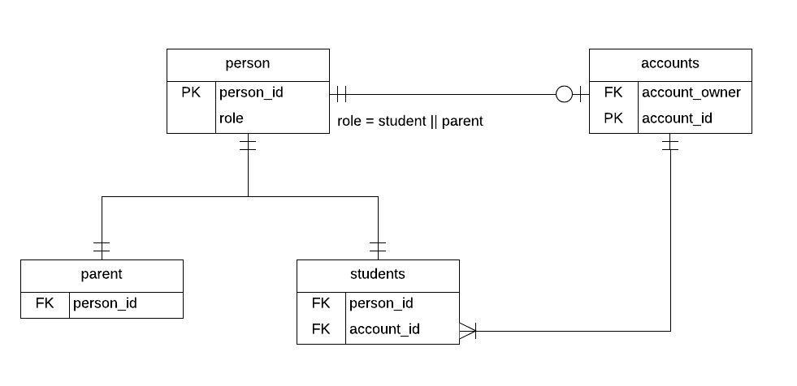
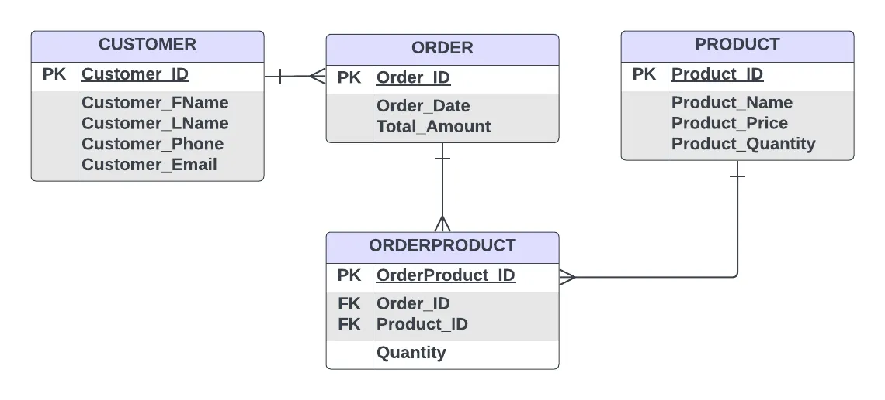
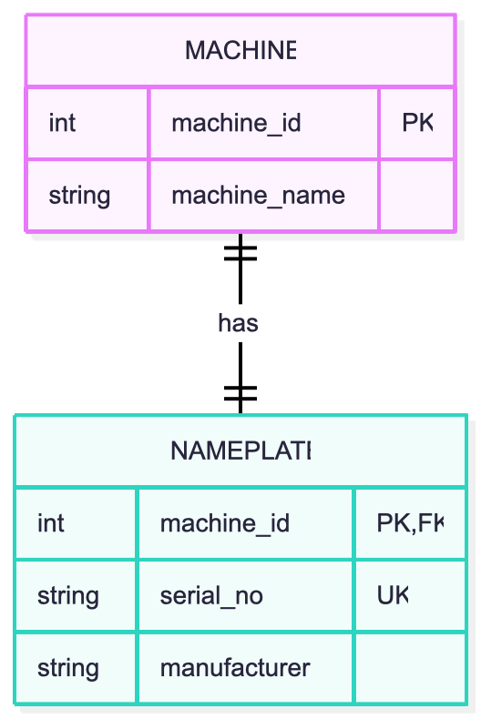
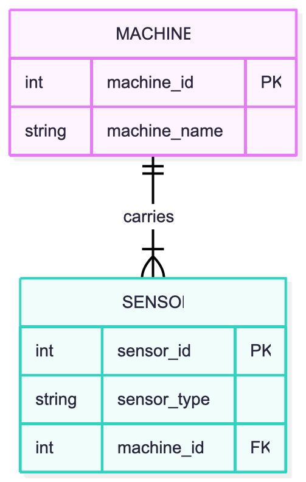
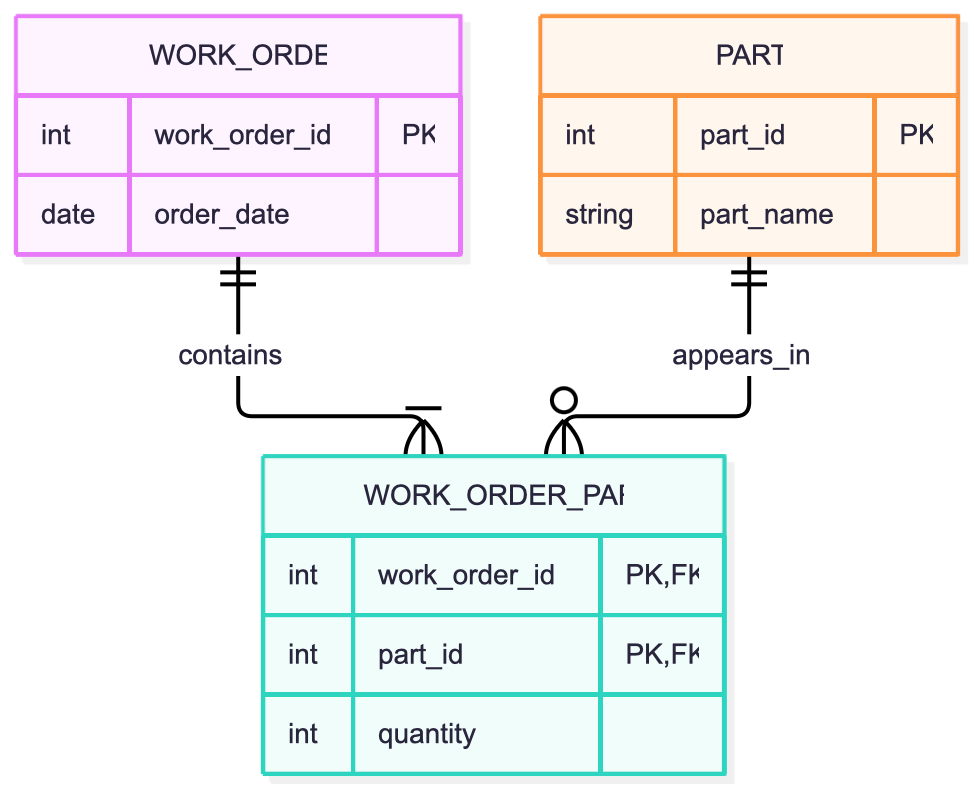
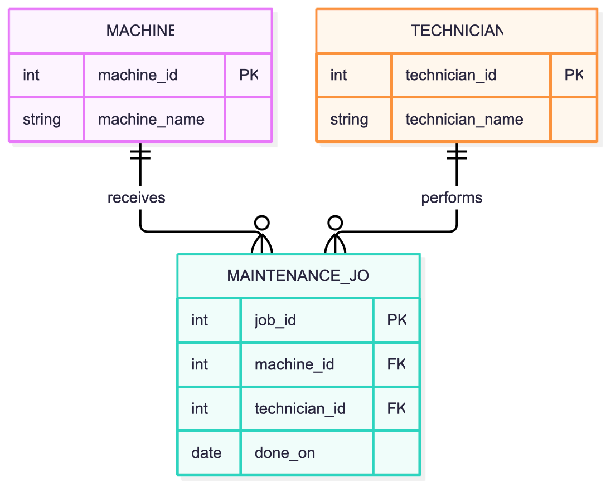

# Module 02 Study Log
# TASK A
## 1. References I used
1. https://deepanshutiw03.medium.com/understanding-entities-attributes-and-entity-relationships-f2c6e3992c02  * I understood the difference between entities (things we store data about), attributes (their properties), and relationships (how entities connect).
2. https://creately.com/guides/crows-foot-notation/ * I learned how circles, lines, and crow’s feet represent optionality and the number of related records.
3. https://www.geeksforgeeks.org/dbms/enhanced-er-model/ * I understood how subclasses inherit common attributes from a superclass, such as Technician and Engineer from Employee.
4. https://www.baeldung.com/sql/keys-natural-vs-surrogate * I learned that natural keys use meaningful existing attributes, while surrogate keys are artificial identifiers.
5. https://www.upistudy.com/blog/database-programming/what-are-1nf-examples-in-databases * I understood that each cell should contain one atomic value rather than a list of values.
6. https://nicolaiarocci.com/sqlite-foreign-key-constraints-are-disabled-by-default/ * I learned that SQLite foreign-key enforcement must be enabled for each database connection.

## 2. Things I googled
1. what is entities, attributes, relationships, cardinality?
- Entities represent objects, attributes describe them, and relationships connect them
2. explain row's-foot / IE notation and how each cardinality is drawn?
- A circle represents zero, a line represents one, and a crow’s foot represents many.
3. Enhanced ER model?
- It extends the basic ER model with concepts such as inheritance, specialization, and subtypes.
4. Natural vs. Surrogate Keys in Database
- Natural keys come from existing data; surrogate keys are artificially created identifiers.
5. Why a comma-separated list breaks 1NF
- Storing multiple values, such as several phone numbers, in one cell violates the atomic-value principle.
6. Why SQLite foreign keys are off by default
- Foreign-key enforcement is disabled by default unless explicitly enabled for the connection.

## 3. Remarkable things
- A relationship in an ER diagram shows not only how many records can be connected, but also whether the relationship is optional or mandatory.

- A natural key may seem suitable but can change or become non-unique when circumstances change; a surrogate key avoids relying on a real-world attribute as the identifier.

- A table can look organized and still violate 1NF if a cell contains a list of values.

## 4. LLM Q&A

### 1. Entity–Relationship Models

**Prompt:** Explain very briefly what entity–relationship models are, with simple examples, highlight the main concepts, and explain how to explain them to a peer.

**Answer summary:** An ER model describes a database’s structure using entities, attributes, and relationships. For example, Student and Course are entities, Name is an attribute, and Enrolls is a relationship.

**Verification:** Compared the definitions with [Medium](https://deepanshutiw03.medium.com/understanding-entities-attributes-and-entity-relationships-f2c6e3992c02) and [Creately](https://creately.com/guides/crows-foot-notation/).

**Errors or limitations:** An ER model describes the structure; an ER diagram is its visual representation. The cardinality of Student–Course depends on the actual requirements.

### 2. Analyze the Legacy Schema

**Prompt:** Here is a legacy schema. What entities, attributes, and relationships does it intend? What cardinalities are hidden in it, and how would I prove each with a COUNT query?

**Answer summary:** The main entities are `machine`, `part`, and `maint_job`. The intended relationships are one machine to many maintenance jobs, and many maintenance jobs to many parts. However, `machine_name` is not a declared foreign key, and `parts_used` stores a list instead of a proper relationship.

**Verification:** Run these queries:

```sql
SELECT m.machine_name, COUNT(j.job_id) AS job_count
FROM machine AS m
LEFT JOIN maint_job AS j
    ON m.machine_name = j.machine_name
GROUP BY m.machine_name;
```

Expected counts from the supplied data: `cnc-01` = 2, `cnc-02` = 1, `cnc-03` = 0, and `RANDOM-NAME` = 0.

```sql
SELECT j.job_id, j.machine_name
FROM maint_job AS j
LEFT JOIN machine AS m
    ON j.machine_name = m.machine_name
WHERE m.machine_name IS NULL;
```

This should find job 3, which references the nonexistent machine `cnc-05`.

**Errors or limitations:** These queries reveal relationships and anomalies in the current data, but counts alone cannot prove that a cardinality is enforced. Primary-key, unique, and foreign-key constraints are needed to enforce the intended rules.

### 3. Natural Keys vs. Surrogate Keys

**Prompt:** Explain the difference between a natural key and a surrogate key, and give one real scenario where choosing the wrong one causes a data bug.

**Answer summary:** A natural key is a meaningful real-world identifier, such as a part number. A surrogate key is an artificial identifier, such as an automatically generated `part_id`. A mutable machine name used as a reference could cause broken links when the name changes.

**Verification:** Checked the definition against [Baeldung](https://www.baeldung.com/sql/keys-natural-vs-surrogate) and the supplied data:

```sql
SELECT part_no, COUNT(*) AS occurrences
FROM part
GROUP BY part_no
HAVING COUNT(*) > 1;
```

The result should show `P-1003` appearing twice.

**Errors or limitations:** A surrogate key does not automatically prevent duplicate business identifiers. If `part_no` must uniquely identify a part, it should also have a `UNIQUE` constraint after the duplicate data is cleaned.

### 4. First Normal Form (1NF)

**Prompt:** A column holds a comma-separated list: `parts_used = 'P-1001,P-1002'`. Why does that violate 1NF, and what would the corrected schema look like?

**Answer summary:** The value contains multiple part numbers in one cell, so it is not atomic. A separate junction table should store one row per maintenance job and part used.

**Verification:** Inspect the supplied job data or run:

```sql
SELECT job_id, parts_used
FROM maint_job
WHERE parts_used LIKE '%,%';
```

This should find job 1. A corrected design would include:

```sql
CREATE TABLE maint_job_part (
    job_id INTEGER NOT NULL
        REFERENCES maint_job(job_id),
    part_no TEXT NOT NULL
        REFERENCES part(part_no),
    quantity INTEGER NOT NULL DEFAULT 1,
    PRIMARY KEY (job_id, part_no)
);
```

Before using this design, `job_id` and `part_no` must be declared as valid primary or unique keys in their respective tables, and duplicate part records must be resolved.

**Errors or limitations:** The junction table fixes the list-in-a-cell problem, but foreign keys will not work reliably unless the referenced columns are valid keys and enforcement is enabled.

### 5. Entity vs. Attribute

**Prompt:** Where exactly is the line between an entity and an attribute? Give an ambiguous example and say who decides.

**Answer summary:** An attribute describes something, while an entity represents something that has its own identity and possibly its own relationships. In this schema, `site` could be a machine attribute or a separate `Site` entity if sites have their own details and many machines belong to them.

**Verification:** Run:

```sql
SELECT site, COUNT(*) AS machine_count
FROM machine
GROUP BY site;
```

The supplied data has three machines at Gütersloh and one at Bielefeld.

**Errors or limitations:** Repeated values alone do not prove that `Site` must become an entity. The decision depends on business requirements and whether site-specific information must be stored and managed separately.

### 6. Crow’s Foot Notation

**Prompt:** Draw Crow’s-foot notation for 1:1, 1:n, and m:n in text, and explain what the crow’s-foot end means.

**Answer summary:**

- 1:1 — `A ||──|| B`
- 1:n — `A ||──o{ B`
- m:n — `A o{──o{ B`

The crow’s foot means “many”; `o` means optional, and `|` means one. These examples show mandatory one-to-one and optional many-side relationships.

**Verification:** Compared the notation with [Creately’s Crow’s Foot guide](https://creately.com/guides/crows-foot-notation/).

**Errors or limitations:** Cardinality notation also specifies optionality. The examples above are not the only possible versions; for example, `|{` means one or more instead of zero or more.

### 7. Real-World Incidents from Missing Foreign Keys or Orphan Rows

**Prompt:** Give three real-world incidents caused by missing foreign keys or orphan rows.

**Answer summary:**
1. **3x-ui:** Orphaned traffic records referenced nonexistent inbound records, causing a SQLite-to-PostgreSQL migration to fail.
2. **Metabase:** Stale permission records in a database dump caused a foreign-key violation during migration.
3. **Prisma ORM:** A schema change left orphaned many-to-many relationship rows, preventing a foreign key from being added successfully.

**Verification:** Read the public issue reports: [3x-ui](https://github.com/MHSanaei/3x-ui/issues/4882), [Metabase](https://github.com/metabase/metabase/issues/78414), and [Prisma ORM](https://github.com/prisma/orm/issues/29968).

**Errors or limitations:** These are reported software issues, not incidents I independently reproduced. They illustrate migration failures caused by orphaned or inconsistent references; they do not establish that every such issue has the same root cause.

## Final Reflection

The main lesson is that a schema can suggest relationships without enforcing them. Primary keys, unique constraints, foreign keys, and normalization make these relationships more reliable and prevent duplicate records, invalid references, and ambiguous data.

## 5. My two best ER sketches
### Sketch 1
- **Source:** https://stackoverflow.com/questions/59140908/representing-an-either-or-relationship-in-crows-foot-erd
- **Image 1:** 
- **What I learned that the other sketch did not show:** The diagram illustrates how to model an either-or rule using subtypes. An account owner must be either a parent or a student, so both can be modeled as subtypes of Person, with an exclusive-subtype rule. This helped me understand that a business rule such as “either A or B, but not both” must be represented explicitly in the data model rather than assumed from ordinary relationships.
### Sketch 2
- **Source:** https://medium.com/@callista.m.azizah/crows-foot-erd-for-beginners-a-tutorial-1effc8a326c6
- **Image 2:** 
- **What I learned that the other sketch did not show:** The diagram shows how a many-to-many relationship between orders and products can be implemented through a junction entity. OrderProduct connects the two entities through foreign keys and stores additional information such as quantity. I learned that information describing a particular relationship belongs in the junction entity, rather than being placed arbitrarily in either parent entity.

# TASK B
## 1. 1:1 — Machine and Nameplate:
Each machine has exactly one nameplate, and each nameplate belongs to exactly one machine. machine_id is the primary and foreign key in Nameplate. The nameplate could also be attributes of Machine if it does not need to be tracked separately.


## 2. 1:n — Machine and Sensor:
One machine has many sensors; each sensor belongs to exactly one machine.The foreign key machine_id goes on the many side, in the Sensor table.


## 3. m:n — Work Order and Part:
A work order uses many parts, and a part can be used in many work orders. WorkOrderPart is the junction table. Its composite primary key (order_id, part_id) ensures a part is listed only once per order.


## 4. Entity vs. Attribute vs. Relationship — Maintenance Job:
Each job concerns one machine and is performed by one technician. A technician can perform many jobs, and a machine can have many jobs. Job is an entity because it has its own ID and date. Technician is also an entity because one technician can perform many jobs; using only a name could cause confusion between people with the same name.


### Proof (sketch 3, m:n)

SQL: [task-b-proof.sql](task-b-proof.sql) · Output: [outputs/task-b-proof.txt](outputs/task-b-proof.txt)

## Agreed learning (pod discussion): Empty since I couldn't attend the Module's class. 